  

  <picture>
    <source media="(prefers-color-scheme: dark)" srcset="https://readme-typing-svg.demolab.com?font=Fira+Code&weight=500&size=20&duration=3200&pause=1400&color=5EEAD4&center=true&vCenter=true&width=700&lines=Ask+an+invoice+a+question.+Get+an+answer.;3.8M%2B+documents%2C+searched+in+under+a+second.;Agents+that+ask+before+they+act.;Winning+team%2C+Google+AI+Booster+Madrid.">
    
  </picture>

  
  
  
  

Accounts payable runs on paperwork: invoices, purchase orders, delivery notes. At [DOST AI](https://dost.io), my team and I make all of it answerable. We search 3.8M+ documents in under a second, extract 100K+ pages a month, and run agents that answer finance questions for customers in ten countries.

### Delivered at DOST AI

- **<mark>3.8M+ documents</mark>, sub-second retrieval.** A production RAG pipeline over invoices, purchase orders and delivery notes. It powers vendor dependency analysis, due-date forecasting and monthly spend projections.
- **<mark>100K+ pages</mark> extracted a month.** FastAPI services that pull every field out of each document (vendor, PO number, due date, payment terms, line items, taxes, totals) into a structured financial knowledge base.
- **Days of onboarding turned into <mark>one guided session</mark>.** InstanceBuilder is a 13-step setup covering ERP connection, invoice ingestion, GL coding, approval workflows and go-live testing.
- **<mark>10+ enterprise customers</mark> onboarded every month.** Vendor field reconciliation is automated across 100+ vendors per customer, which halved each mapping batch to <mark>5 minutes</mark>.
- **Discrepancies caught <mark>before approval</mark>.** Three-way matching of invoice, PO and delivery note now also checks line items against each customer's contract terms.
- **Agents that <mark>ask before they act</mark>.** AskDOST answers plain-language questions about invoices and workflows through a streaming Claude tool-use loop over MCP. Every write waits for the user's approval, and every call is traced with OpenTelemetry while customer financial data stays out of telemetry.
- **DOST's <mark>official Claude connector</mark>**, with OAuth 2.0 + PKCE, SSO token exchange, and Azure Managed Identity so no storage secrets live in the environment.

### Products I've built

- **<mark>Live at UNCW</mark> and other US universities.** [UniversityTHRIVE](https://universitythrive.ai/) forms and schedules cohorts automatically. Recurring meetings hold their local time across DST changes, and moving one session updates only that occurrence in Google Calendar and Outlook.
- **Empty repo to <mark>production, solo</mark>.** AcadaME is an AI academic advising platform with text and real-time voice. Its hybrid search fuses HNSW vector search with full-text ranking on pgvector, using a similarity floor and 6× over-fetch re-ranking.
- **Learning pathways in <mark>seconds instead of months</mark>.** A course-recommendation engine that matches university syllabi to professional-development modules and assembles a personalized pathway for each goal.

### Research & recognition

- **<mark>Winning team</mark>**, Google AI Booster Program, Madrid
- **<mark>0.90 BERTScore</mark>** on MICCAI: fine-tuned Falcon-7B with 4-bit QLoRA on a single T4 GPU to write research abstracts from full papers
- **Co-author**, *Choices for Measuring Cognitive Function Digitally in Low- and Middle-Income Countries*, American Epilepsy Society
- **Dean's List**, FAST National University · now doing an MSc in Data Science & Analytics at [EPITA](https://www.epita.fr/), Paris

### Public projects

Most of the work above is in private repos. These are smaller projects I've open-sourced.

| Project | What it does | Built with |
|---|---|---|
| [Doctor Consultation Analyser](https://github.com/talalmuzaffar/Doctor-Consultation-Analyser-using-Whisper-and-Llama) | Turns recorded Urdu doctor–patient consultations into structured English clinical notes | Whisper Large v3, Llama 3.2 |
| [Recruitment System](https://github.com/talalmuzaffar/Recruitment-System-Powered-by-LLama-3.1) | Semantic search and chat over résumés, interview transcripts and job descriptions | Llama 3.1, Qdrant, LangChain |
| [Eye Disease Classification](https://github.com/talalmuzaffar/Eye-Diseases-Classification-using-VLM) | Screens eye photos for cataract, conjunctivitis and pterygium with a vision-language model | Llama 3.2 Vision, Streamlit |
| [CSVChat](https://github.com/talalmuzaffar/CSVChat) | Ask questions about any CSV file in plain English | LangChain Pandas agent |
| [Similar Songs with LSH](https://github.com/talalmuzaffar/Finding-Similar-Songs-using-Locality-Sensitive-Hashing) | Finds similar tracks from MFCC audio features using locality-sensitive hashing | Python, Flask |
| [Energy Load Forecasting](https://github.com/talalmuzaffar/DataMiningForecasting) | Compares LSTM, ANN, SVR, Prophet and ETS forecasts on energy load data | TensorFlow, Prophet, statsmodels |
| [Shortest Paths on Hadoop](https://github.com/talalmuzaffar/Shortest-Path-Analysis-on-Large-Graphs-using-Hadoop) | BFS over a 4.3M-node graph as a MapReduce job, benchmarked against a single-machine run | Hadoop, Python |

### Tools

<picture>
  <source media="(prefers-color-scheme: dark)" srcset="https://skillicons.dev/icons?i=py,pytorch,fastapi,postgres,redis,docker,kubernetes,azure,gcp,ts,nextjs,githubactions&theme=dark&perline=12">
  
</picture>

Plus LangChain, LangGraph, MCP, Claude, Llama, Hugging Face, Qdrant, pgvector, LayoutLM, Azure Document Intelligence and OpenTelemetry.

 

<picture>
  <source media="(prefers-color-scheme: dark)" srcset="https://raw.githubusercontent.com/talalmuzaffar/talalmuzaffar/output/github-snake-dark.svg">
  
</picture>
