  

  <picture>
    <source media="(prefers-color-scheme: dark)" srcset="https://readme-typing-svg.demolab.com?font=Fira+Code&weight=500&size=20&duration=3200&pause=1400&color=5EEAD4&center=true&vCenter=true&width=700&lines=I+build+AI+that+reads+documents+so+people+don%27t+have+to;RAG+over+3.8M%2B+invoices%2C+POs+and+delivery+notes;Agents+on+MCP%2C+with+a+human+approving+every+write;From+ML+intern+to+ML+Lead+at+DOST+AI">
    
  </picture>

  
  
  
  

I lead the ML team at [DOST AI](https://dost.io), where we build AI that reads financial documents so finance teams don't have to. That means a RAG system over 3.8M+ invoices, purchase orders and delivery notes, extraction that handles 100K+ pages a month, and agents that answer questions about all of it for customers in ten countries.

### How I got here

**Islamabad.** I studied data science at FAST National University, where I worked as a teaching assistant and made the Dean's List. My first real ML work was in healthcare. I co-authored a paper on measuring cognitive function digitally in low- and middle-income countries, presented at the American Epilepsy Society. At the university's KDD Lab, I fine-tuned LLaMA, Falcon, BART, Phi and Gemma on medical text. One run fit Falcon-7B onto a single T4 GPU with 4-bit QLoRA and trained it to write research abstracts from full papers, reaching a BERTScore of 0.90 on MICCAI.

**DOST AI.** I joined DOST AI, a Barcelona company that automates accounts payable, as an ML intern. My job was to show that OCR, entity extraction and retrieval could hold up on real customer invoices. That work turned into a full-time offer, and I built it out into the extraction services and RAG pipeline the product runs on, with sub-second retrieval across millions of documents.

I led DOST's team to a win at Google's AI Booster Program in Madrid and was promoted to ML Lead, where I run a team of five. I built AskDOST, which lets customers ask about their invoices and approval workflows in plain language. It runs a streaming Claude tool-use loop over DOST's MCP server, nothing gets written without the user confirming it, and every call is traced with OpenTelemetry while customer financial data stays out of the logs. I also led DOST's official Claude connector and built InstanceBuilder, which replaced days of onboarding back-and-forth with one guided session.

**Paris.** I now live in Paris, where I'm doing an MSc in Data Science & Analytics at [EPITA](https://www.epita.fr/) while leading ML at DOST AI.

### Products I've built

- **[UniversityTHRIVE](https://universitythrive.ai/)** forms and schedules cohorts at UNCW and other US universities. Recurring meetings stay at the right local time across DST changes, and moving one session updates only that occurrence in Google Calendar and Outlook.
- **AcadaME** is an AI academic advising platform with text and real-time voice. I built it alone, from an empty repo to production, with hybrid vector and full-text search on pgvector.
- **A course-recommendation engine for universities** that matches syllabi to professional-development modules and builds personalized learning pathways.

### Public projects

Most of the work above is in private repos. These are smaller projects I've open-sourced.

| Project | What it does | Built with |
|---|---|---|
| [Doctor Consultation Analyser](https://github.com/talalmuzaffar/Doctor-Consultation-Analyser-using-Whisper-and-Llama) | Turns recorded Urdu doctor–patient consultations into structured English clinical notes | Whisper Large v3, Llama 3.2 |
| [Recruitment System](https://github.com/talalmuzaffar/Recruitment-System-Powered-by-LLama-3.1) | Semantic search and chat over résumés, interview transcripts and job descriptions | Llama 3.1, Qdrant, LangChain |
| [Eye Disease Classification](https://github.com/talalmuzaffar/Eye-Diseases-Classification-using-VLM) | Screens eye photos for cataract, conjunctivitis and pterygium with a vision-language model | Llama 3.2 Vision, Streamlit |
| [CSVChat](https://github.com/talalmuzaffar/CSVChat) | Ask questions about any CSV file in plain English | LangChain Pandas agent |
| [Similar Songs with LSH](https://github.com/talalmuzaffar/Finding-Similar-Songs-using-Locality-Sensitive-Hashing) | Finds similar tracks from MFCC audio features using locality-sensitive hashing | Python, Flask |
| [Energy Load Forecasting](https://github.com/talalmuzaffar/DataMiningForecasting) | Compares LSTM, ANN, SVR, Prophet and ETS forecasts on energy load data | TensorFlow, Prophet, statsmodels |
| [Shortest Paths on Hadoop](https://github.com/talalmuzaffar/Shortest-Path-Analysis-on-Large-Graphs-using-Hadoop) | BFS over a 4.3M-node graph as a MapReduce job, benchmarked against a single-machine run | Hadoop, Python |

### Tools

<picture>
  <source media="(prefers-color-scheme: dark)" srcset="https://skillicons.dev/icons?i=py,pytorch,fastapi,postgres,redis,docker,kubernetes,azure,gcp,ts,nextjs,githubactions&theme=dark&perline=12">
  
</picture>

Plus LangChain, LangGraph, MCP, Claude, Llama, Hugging Face, Qdrant, pgvector, LayoutLM, Azure Document Intelligence and OpenTelemetry.

 

<picture>
  <source media="(prefers-color-scheme: dark)" srcset="https://raw.githubusercontent.com/talalmuzaffar/talalmuzaffar/output/github-snake-dark.svg">
  
</picture>
